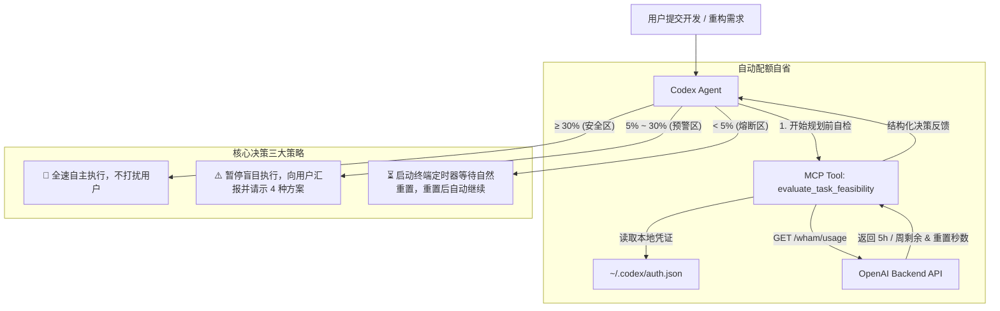

# Codex Quota Guard 🛡️

<div align="center">

**为 OpenAI Codex 量身打造的算力配额感知与任务自动续航插件**  
*赋予 Codex Agent 算力自省能力，拒绝写到一半被 429 强制掐断！*

[](LICENSE)
[](https://www.python.org/)
[](https://modelcontextprotocol.io/)
[]()
[-blueviolet.svg)]()

[功能特性](#-核心特性) • [一键部署](#-一键部署) • [工作原理](#-工作原理) • [交互效果](#-交互与决策效果) • [常见问题](#-常见问题)

</div>

---

## 📌 为什么需要 Codex Quota Guard？

随着 OpenAI 为 Codex（CLI / 桌面端）引入 **5 小时短周期滚动窗口** 与 **7 天周度限额** 的双重约束，开发者在进行大规模代码重构、全工程检索或长上下文推理时，经常面临突发撞线：
* ❌ **痛点 1**：Codex 在执行耗时任务时对自身剩余算力一无所知，经常在改了 80% 代码的关键时刻突然触发 HTTP 429 报错中断，导致上下文断层、心智负担剧增。
* ❌ **痛点 2**：传统查额工具（如状态栏插件）仅供人类肉眼查看，Agent 自身无法读取，无法在规划阶段做出自适应决策。
* ❌ **痛点 3**：不小心消耗了账号珍贵的“即时重置额度”（Banked Reset Credits）。

**Codex Quota Guard** 基于 **MCP（Model Context Protocol）标准协议** 与 **Codex 原生 Skill 体系** 构建，为 Codex 接入实时的官方算力监控，让智能体在动手前**先看算力、科学规划、自动续航**！

---

## ✨ 核心特性

* 🔍 **双重限额精准探测**：
  * **5 小时短周期滚动限额**：精准计算已用/剩余百分比，实时计算下次窗口刷新倒计时（时/分）。
  * **7 天周度全局限额**：实时掌握本周宏观配额消耗，防止周末无额度可用。
* ⚖️ **两道硬性红线自决策**：
  * **剩余额度 < 30% 时**：Codex **强制暂停自主盲目推进**，主动向用户汇报并提供 4 种执行策略供用户挑选。
  * **剩余额度 < 5% 时**：Codex **自动在终端启动定时等待脚本**，倒计时至配额自然恢复后，**自动无缝续接原任务**，无需人工干预催促！
* 🚫 **绝对禁止动用重置点（Zero Reset Credits Policy）**：
  * 全流程代码与 Prompt 双重严控，任何情况下严禁消耗、触发或引导使用账号的即时重置点，仅依赖自然时间轮转。
* 🔌 **零第三方依赖（Pure Standard Library）**：
  * 纯 Python 3 原生标准库开发，无需执行 `pip install`，无网络装包烦恼与环境版本冲突。
* 🚀 **跨电脑极简一键部署**：
  * Windows 用户解压后**双击 `install.bat` 即可全自动部署**；
  * macOS / Linux 用户运行 `./install.sh` 即可自动适配当前 Python 路径并注册配置。
* 🖥️ **双模运行与桌面即开小工具**：
  * 既作为 Codex 后台调用的 MCP 服务，也可在终端直接运行 `cli.py`（Windows 用户双击 `check_quota.bat`），秒开文本进度条仪表盘。

---

## 📐 工作原理



---

## 🚀 一键部署

把本项目下载或克隆到电脑任意目录：

### 🪟 Windows（最简方式）
1. 双击运行项目根目录下的 **`install.bat`**；
2. 脚本会自动寻找系统 Python、自动获取绝对路径、备份并更新 `~/.codex/config.toml`、安装 Agent 技能；
3. **彻底重启一次 Codex 客户端**（在系统托盘右键退出后重开）即可！

> 💡 **随时查看配额**：平时想看当前额度，直接双击 **`check_quota.bat`** 即可弹出仪表盘控制台。

### 🍎 macOS / Linux
打开终端进入项目根目录：
```bash
chmod +x install.sh
./install.sh
```

### 🐍 命令行通用部署
如果你习惯使用命令行或指定特定的 Python 环境（例如虚拟环境、Conda 等）：
```bash
python deploy.py
```

---

## 🎮 交互与决策效果

### 1. 额度充裕时（≥ 30%）
你无需特意吩咐，Codex 在规划阶段自动静默自检通过，全速推进任务编写与代码重构，保持高效交付。

### 2. 额度预警时（5% ~ 30%）
Codex 会停下来向你主动询问：
> “当前 5 小时配额仅剩 **22.5%**，距离下次重置还需 **1 小时 15 分钟**。按照规则，请问您希望如何推进当前任务？
> * **方案 A（精简核心）**：仅修改关键文件，压缩上下文与推理难度；
> * **方案 B（切片确认）**：将任务严格切分为若干原子步骤，每完成一步向您汇报确认一次；
> * **方案 C（全速冲刺）**：保持原方案继续执行；
> * **方案 D（暂缓等待）**：暂停当前任务，等待额度自然重置后再继续。”

### 3. 额度临界时（< 5% 或已受限）
Codex 会自动通知你并挂起定时器：
> “当前配额已低于 5%（剩余 **2.0%**），距离自然重置还需 **35 分钟**。按规定严禁使用任何即时重置点，我已在终端启动定时等待脚本，倒计时结束后将自动继续完成您交给我的任务。”

*终端中的 `wait_reset.py` 脚本倒计时结束并复核配额已恢复后正常退出（exit 0），Codex 会话立即被自动唤醒，无缝继续编写代码！*

### 4. 独立桌面/终端仪表盘效果
随时运行 `python cli.py`（或双击 `check_quota.bat`）：
```text
============================================================
           Codex 实时配额与任务决策监测台
============================================================
账号邮箱:   user@example.com
订阅套餐:   PLUS Plan
服务状态:   正常可用 (Allowed)
即时重置点: 1 个可用 (已锁定保护)
------------------------------------------------------------
[1] 5 小时滚动窗口 (短周期):
    使用进度:   [------------------------]   0.0%
    剩余可用:   100.0%
    重置倒计时: 约 4小时 45分钟
    健康状态:   HEALTHY

[2] 本周全局窗口 (长周期):
    使用进度:   [=-----------------------]   6.0%
    剩余可用:   94.0%
    重置倒计时: 约 5天 12小时
    健康状态:   HEALTHY
============================================================
自决策状态:   PROCEED (EXECUTE_NORMALLY)
执行指导:     [OK] 配额充足。无需打扰用户，全速自主推进当前任务。
============================================================
```

---

## 📁 仓库文件结构

```text
codex-quota-guard/
├── install.bat           # Windows 一键自动部署入口（双击运行）
├── uninstall.bat         # Windows 一键完全卸载与还原入口（双击运行）
├── check_quota.bat       # Windows 桌面快速查看配额小工具（双击运行）
├── install.sh            # macOS / Linux 一键部署脚本
├── deploy.py             # 跨平台自适应部署引擎（自动提取环境、动态注入）
├── quota_client.py       # 核心业务模块：凭据解析、后端查询与红线决策算法
├── server.py             # 标准 MCP stdio 服务器（提供两个工具）
├── wait_reset.py         # 专供低于 5% 时阻塞等待并驱动自动续航的定时脚本
├── SKILL.md              # 注入 Codex 的行为准则规范模板
├── cli.py                # 终端直显仪表盘程序
├── test_mcp.py           # MCP 协议端到端自测用例
└── README.md             # 项目说明文档
```

---

## 🛠️ 一键卸载与环境复原

如需彻底移除该插件：
* **Windows**：直接双击运行 **`uninstall.bat`**；
* **macOS / Linux**：终端执行 `./install.sh --uninstall` 或 `python deploy.py --uninstall`。

脚本会自动：
1. 还原备份的 `~/.codex/config.toml` 配置；
2. 清理安装在 `~/.codex/skills/quota-aware-planner/` 中的技能定义。

---

## ❓ 常见问题 (FAQ)

### Q1: 插件是如何读取到配额的？需要输入密码或 API Key 吗？
不需要！只要你在本地通过官方命令执行过一次 `codex login`，登录凭证就会保存在本地 `~/.codex/auth.json` 中。本插件直接读取本地 session 凭证向官方使用量端点发起只读查询，**绝不上传任何凭证至任何第三方服务器**。

### Q2: 部署完成后，Codex 提示“当前会话看不到工具”？
1. 请确保彻底退出了一次 Codex（桌面客户端请在系统托盘图标右键完全退出，然后再打开）；
2. 本项目内置了**双保险机制（Dual Redundancy）**：即便由于客户端原因 MCP 偶尔未能挂载，Codex 也会根据技能准则自动在终端运行 `cli.py` 快速提取配额并完成决策。

### Q3: 为什么要求严禁动用重置点（Reset Credits）？
重置点通常是官方根据套餐赠送或购买的极其宝贵的一次性权益。日常开发中，遇到限额只需要短暂等待 5 小时窗口重置即可，不应让 Agent 在自动化循环中随意消耗。

---

## 📄 开源许可证

本项目采用 [MIT License](LICENSE) 授权许可，欢迎提 Issue 和 Pull Request 共建！
